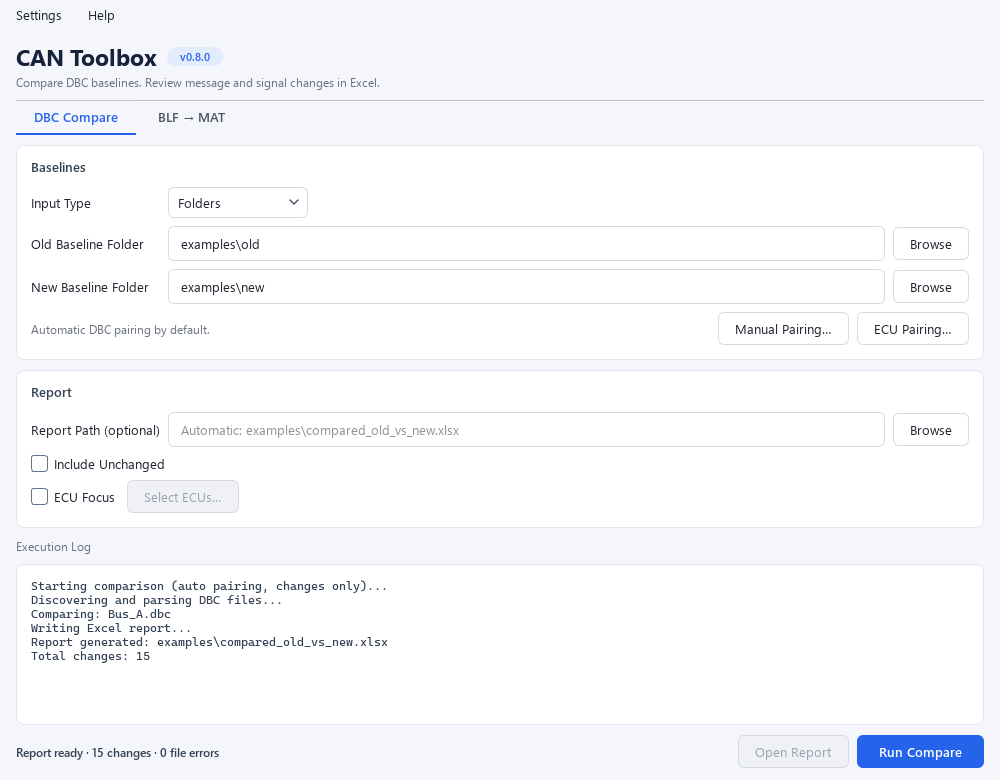
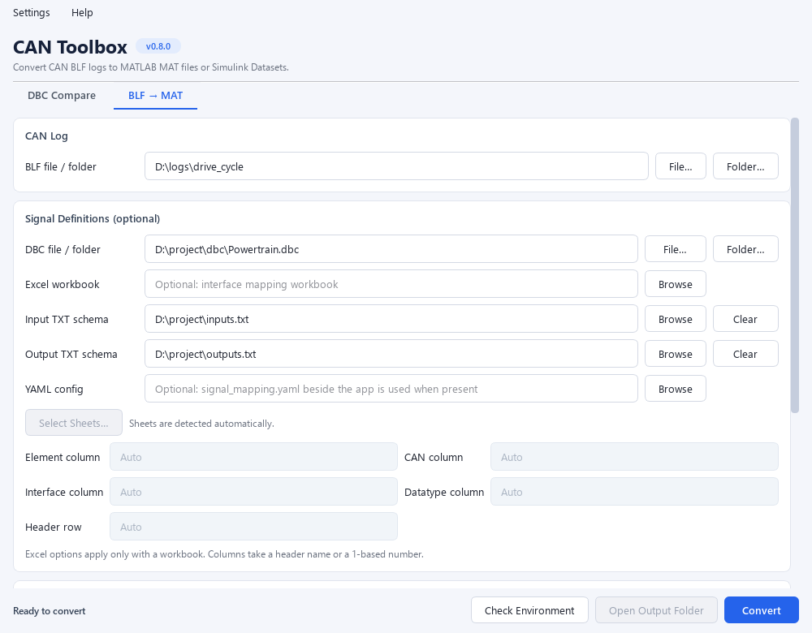

<div align="center">

# CAN Toolbox

**View CAN logs, compare DBC baselines in Excel and convert BLF logs to MATLAB.**

[](https://github.com/longvo92/can-toolbox/actions/workflows/test.yml)
[](pyproject.toml)
[](LICENSE)

[Download](https://github.com/longvo92/can-toolbox/releases/latest) · [Quick start](#quick-start) · [User Guide](resources/help/user_guide.md) · [Changelog](CHANGELOG.md)

</div>

A Windows desktop app with three tools in one window. **Log Viewer** shows BLF, ASC and MF4 logs as a CANoe-style trace decoded with your DBC files. **DBC Compare** finds added, removed, modified and renamed messages and signals between two DBC files or baseline folders and exports an Excel report. **BLF → MAT** converts CAN BLF logs to MATLAB `.mat` files or Simulink Signal Editor Datasets.

## Features

| Tool | Use it to |
|---|---|
| DBC Compare | Compare DBC files or whole baselines, pair renamed files and ECU nodes, focus on selected ECUs, review OLD/NEW values in Excel |
| BLF → MAT | Export raw CAN frames, decode signals with DBC files, map them to model interfaces from Excel, TXT or YAML, write MAT or Simulink Datasets |
| Log Viewer | Trace BLF, ASC and MF4 logs with per-channel DBCs, decoded signal values, ID/name filters, find, fixed-position mode and per-message cycle statistics; plot signals with synchronized measurement cursors |
| All | English or Vietnamese interface, drag & drop paths, settings remembered between sessions |






## Quick start

1. Download the Windows `.exe` from [Releases](https://github.com/longvo92/can-toolbox/releases/latest) and open it. No Python installation is needed.
2. **DBC Compare:** choose **Files** or **Folders**, select OLD and NEW, click **Run Compare**, then **Open Report**.
3. **BLF → MAT:** select a BLF file or folder, optionally a DBC and mapping files, click **Convert**, then **Open Output Folder**.
4. **Log Viewer:** click **Open Log…**, add DBCs with **DBC Files…**, then select a frame to see its signals or double-click a signal to plot it.

Sample DBCs are in [examples/old](examples/old) and [examples/new](examples/new); BLF mapping examples are in [examples/blf](examples/blf).

## Outputs

| Tool | Output |
|---|---|
| DBC Compare | `compared_<old>_vs_<new>.xlsx` beside NEW, or a path you choose: Summary, DBC Overview (folders), Message Details and Signal Details |
| BLF → MAT | `mat_output` beside the log: `<log>.mat` raw frames, `<log>_signals.mat` DBC signals, or `<log>_input.mat` and `<log>_output.mat` for mapped interfaces |

## Requirements

- Windows for the packaged app.
- MATLAB only for the Simulink Dataset format; MAT output needs no MATLAB.
- Python 3.11+ to run from source.

## Install from source

```powershell
git clone https://github.com/longvo92/can-toolbox.git
cd can-toolbox
py -m venv .venv
.\.venv\Scripts\python.exe -m pip install -e .
.\run_gui.bat
```

## Limitations

- The app is GUI-only; there is no command line mode. Version 0.8.0 of DBC Compare Tool remains available for scripted comparisons.
- DBC rename detection is heuristic; review Medium and Low confidence rows. Moves across messages or files appear as Added/Removed.
- BLF → MAT keeps native CAN timestamps and does not resample.
- Log Viewer cannot cut logs yet and never replays or simulates. BLF objects other than CAN frames (markers, LIN, Ethernet) are listed in **Log Info**, not shown in the trace.

## Documentation

- [User Guide](resources/help/user_guide.md) · [Hướng dẫn tiếng Việt](resources/help/user_guide_vi.md)
- [Architecture](docs/architecture.md) — components, rules, testing and builds
- [Changelog](CHANGELOG.md)

## License

[MIT](LICENSE) · Long Vo Thien
