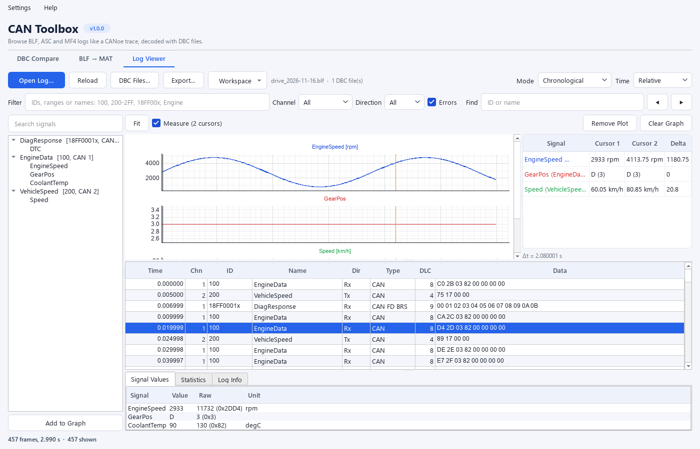
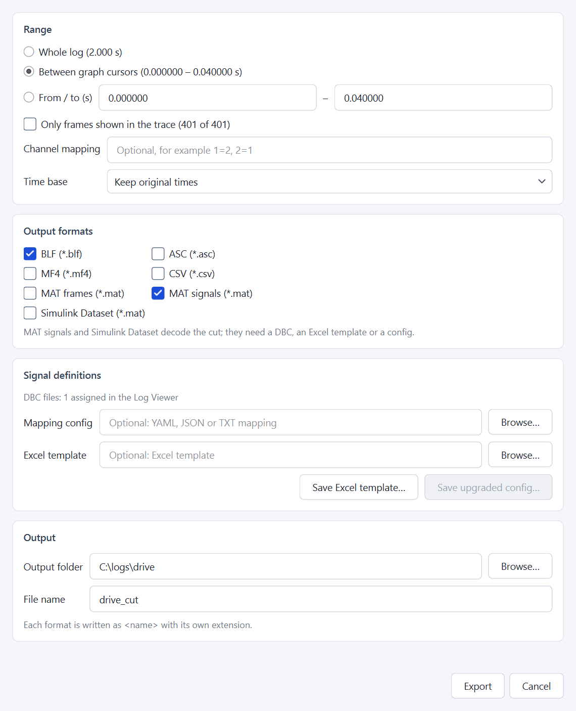

<div align="center">

# CAN Toolbox

**Read CAN logs like a trace, plot the signals, cut and convert them — and compare DBC baselines in Excel.**

[](https://github.com/longvo92/can-toolbox/actions/workflows/test.yml)
[](pyproject.toml)
[](LICENSE)

[Download](https://github.com/longvo92/can-toolbox/releases/latest) · [Quick start](#quick-start) · [User Guide](resources/help/user_guide.md) · [Migrating from 1.0](docs/migration-2.0.md) · [Changelog](CHANGELOG.md)

</div>

A Windows desktop app for CAN work. The window **is** a log viewer: BLF, ASC, MF4, PEAK
TRC, candump and CSV logs as a CANoe-style trace decoded with your DBC files — expand a frame to read its
signals — several logs open at once, signals grouped in a list beside the graph and
plotted on a shared time axis with measurement cursors, and one **Export** window that
writes the cut as BLF, ASC, MF4, CSV, MAT frames, MAT signals or a Simulink Dataset.
**DBC Compare** opens from the Tools menu and reports added, removed, modified and
renamed messages and signals in Excel.



## Features

| Area | Use it to |
|---|---|
| Trace | Open BLF, ASC, MF4, PEAK `.trc`, candump `.log` and CSV logs, assign DBCs per channel, expand a frame into its decoded signals, filter by ID, range or name, find, fixed-position mode, per-message cycle statistics |
| Logs | Keep several logs open, switch which one the window shows, and export, reload or close any of them from the Logs panel |
| Graphics | Group the plotted signals, tick what is drawn, read each one's **Value**, raw **y**, Min, Max and Δ at the cursors, Fit / Fit X / Fit Y, zoom, step to the next value change, save the plots as a PNG |
| Export | One window: range (whole log, between cursors, trace filter), channel map, time base, and as many output formats as you need from the same cut |
| DBC Compare | Compare DBC files or whole baselines, pair renamed files and ECU nodes, focus on selected ECUs, review OLD/NEW values in Excel |
| Everywhere | Light and dark theme (or follow Windows), English or Tiếng Việt, drag & drop, dockable panels, workspaces, settings remembered |

<div align="center">



</div>

## Quick start

1. Download the Windows `.exe` from [Releases](https://github.com/longvo92/can-toolbox/releases/latest) and open it. No Python installation is needed.
2. **File → Open Log…** (or drop `.blf`, `.asc`, `.mf4`, `.trc`, `.log` or `.csv` files on the window — several at once is fine), then **File → DBC Files…** to assign databases to channels.
3. Expand a frame in the trace to read its signals. Open **View → Signal Browser** and double-click a signal to plot it; the list beside the graph holds the plots, in groups if you want them.
4. **Export…** cuts the log and writes the formats you tick.
5. **Tools → DBC Compare…** opens the comparison in its own window; **Settings → Settings…** holds language, theme and the MATLAB executable.

Sample DBCs are in [examples/old](examples/old) and [examples/new](examples/new); mapping examples are in [examples/blf](examples/blf).

## Outputs

| Job | Output |
|---|---|
| Export, frame formats | `<name>.blf`, `.asc`, `.mf4`, `.csv` or `.mat` (the `Frames` struct: time, ID, data, DLC, flags) |
| Export, MAT signals | `<name>.mat`, or `<name>_input.mat` and `<name>_output.mat` when a mapping names both sides |
| Export, Simulink Dataset | `<name>.mat`, packaged by one headless MATLAB run |
| DBC Compare | `compared_<old>_vs_<new>.xlsx` beside NEW, or a path you choose: Summary, DBC Overview (folders), Message Details, Signal Details |

## Requirements

- Windows for the packaged app.
- MATLAB only for the Simulink Dataset format; MAT output needs no MATLAB.
- Python 3.11+ to run from source.

## Install from source

```powershell
git clone https://github.com/longvo92/can-toolbox.git
cd can-toolbox
py -m venv .venv
.\.venv\Scripts\python.exe -m pip install -e .
.\run_gui.bat
```

## Limitations

- The app is GUI-only; there is no command line mode. Version 0.8.0 of DBC Compare Tool remains available for scripted comparisons.
- Export works on the log that is open. Converting a folder of logs in one run was removed in 2.0; see [Migrating from 1.0](docs/migration-2.0.md).
- DBC rename detection is heuristic; review Medium and Low confidence rows. Moves across messages or files appear as Added/Removed.
- Every output format uses the file name you type. MAT frames, MAT signals and a Dataset all write `<name>.mat`, so picking more than one of them in a run leaves only the last.
- A CSV written by Export opens again here, but it carries no error-state-indicator flag.
- Signals keep their native CAN timestamps; nothing is resampled.
- The viewer never replays or simulates. BLF objects other than CAN frames (markers, LIN, Ethernet) are listed in **Log Info**; they are not shown in the trace or copied into a cut.

## Documentation

- [User Guide](resources/help/user_guide.md) · [Hướng dẫn tiếng Việt](resources/help/user_guide_vi.md)
- [Migrating from 1.0](docs/migration-2.0.md) — the window, Export and the mapping schema
- [Architecture](docs/architecture.md) — components, rules, testing and builds
- [Changelog](CHANGELOG.md)

## Only comparing DBC files?

The comparison here is shared with [dbc-compare-tool](https://github.com/longvo92/dbc-compare-tool),
a smaller app that does just that job: same engine, same Excel report, no log viewer and a
download a fraction of the size. This repository vendors its code; that one is where it lives.

## License

[MIT](LICENSE) · Long Vo Thien
